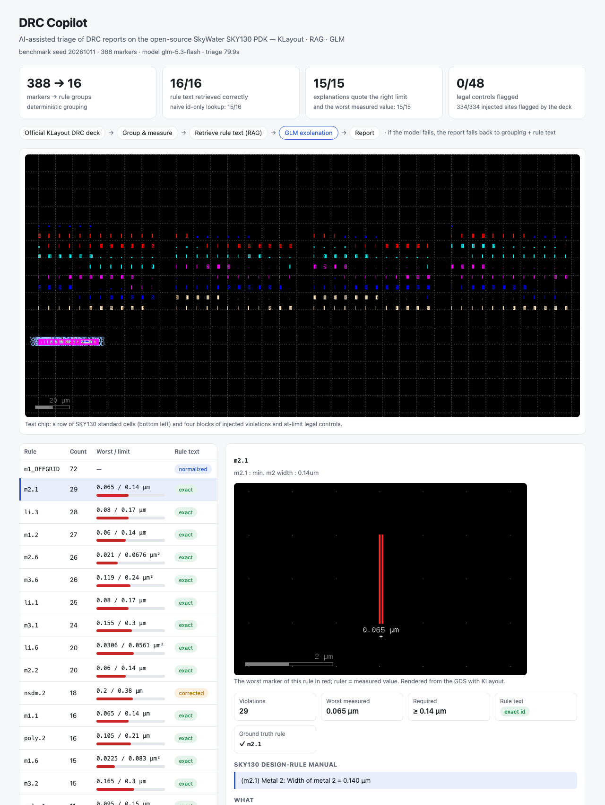

# DRC Copilot

AI-assisted triage of DRC (design-rule check) reports on the open-source SkyWater **SKY130** PDK.

> **Status: working prototype (Oct 2026).** All numbers below come from measured runs (`tools/evaluate.py`).



## What it does

A full-chip DRC run can report thousands of violations. DRC Copilot turns the raw report into a one-page triage:

1. **Group & measure** — parse the KLayout report database (`.lyrdb`), group violations by rule and compute the worst
   measured width / spacing / area against the limit, deterministically. No model is involved, so this is also the
   fallback output when the model path fails.
2. **Retrieve** — look up the governing rule text in the SKY130 periphery design-rule table
   (exact rule id first, lexical similarity as a fallback) — the retrieval half of RAG.
3. **Explain** — send the retrieved rule text, the measured values and sample markers to the Zhipu GLM API and ask for
   *what is violated / likely causes / suggested fixes* as JSON, grounded in the retrieved text only.
4. **Report** — write a Markdown report: summary table + one section per rule group.
5. **Evaluate** — inject known violations into a clean layout, so accuracy is measured against ground truth.

## Run

```bash
/usr/bin/python3 tools/make_testchip.py                     # clean row of SKY130 standard cells
/usr/bin/python3 tools/inject_random.py                     # benchmark: violations + at-limit controls
tools/run_drc.sh work/bench.gds work/bench.lyrdb            # open-source SKY130 KLayout deck (sky130A_mr.drc)
/usr/bin/python3 run.py work/bench.lyrdb --out out/bench_glm.md      # needs ZHIPUAI_API_KEY in .env
/usr/bin/python3 run.py work/bench.lyrdb --no-llm                   # rule-only fallback
/usr/bin/python3 tools/evaluate.py --lyrdb work/bench.lyrdb --truth work/bench_truth.json --run out/bench_glm.json
```

## Demo

```bash
/usr/bin/python3 app.py          # then open http://127.0.0.1:8765
```

The page shows the triage of the latest run: headline numbers, the test chip, one row per rule group, and for the
selected group a KLayout render of its **worst** marker (red, with a ruler showing the measured value), the measured vs
required value, the retrieved SKY130 rule text and the GLM explanation. **Run live** rebuilds everything from scratch —
new benchmark (seed / size of your choice) → official DRC deck → triage → snapshots → scoring — in about 5 s with the
model off and ~1.5 min with GLM on. A static copy of the page can be built with `python3 -m drc_copilot.site`.

## Data and licences

- `data/sky130_periphery_rules.csv` — from [google/skywater-pdk](https://github.com/google/skywater-pdk)
  `docs/rules/periphery/periphery.csv`, Apache License 2.0.
- PDK and the KLayout DRC deck (`sky130A_mr.drc`, GPLv3) are installed with [volare](https://github.com/efabless/volare)
  and are not redistributed here.

## Results (benchmark seed 20261011, model glm-5.3-flash)

| What | Result |
|---|---|
| Benchmark | 334 injected violations (16 rule types, 4 blocks) + 48 legal controls drawn exactly at the limit |
| Detection by the deck (sanity check of the benchmark, not of this tool) | 334/334 flagged · 0/48 controls flagged |
| Triage | 388 markers → 16 rule groups, each with worst measured value vs required limit |
| Top-1 rule-text retrieval | **16/16** · naive id-only lookup 15/16 |
| Model answers | 16/16 valid JSON · correct limit quoted 15/15 · worst measured value quoted 15/15 |
| Fallback (model path forced to fail) | report still complete: 16/16 groups with rule text, 2.9 s |
| Runtime | ~1.5–2 min for 16 groups with 4 parallel model calls |

**Two data issues found along the way**

- The open-source KLayout deck numbers the n+ implant checks opposite to the SKY130 manual
  (`nsdm.1` = spacing, `nsdm.2` = width; manual `nsd.1` = width, `nsd.2` = spacing). Id-only lookup would attach the
  spacing rule to width violations; a type-consistency check (width / spacing / area / enclosure) catches it and
  re-retrieves by meaning (`corrected` in the report).
- The rule table gives the manufacturing grid (`x.1a/x.1b`) in mm; it is µm. Manual review caught the model repeating
  the inconsistency; the unit is now corrected at load time and labelled in the retrieved text.

## Example output

- [`examples/bench_report.md`](examples/bench_report.md) — the triage report for the benchmark (with GLM explanations)
- [`examples/eval.md`](examples/eval.md) — the evaluation summary
- [`examples/bench_truth.json`](examples/bench_truth.json) — the injected ground truth (regenerate with `tools/inject_random.py`)

## Limitations

- The benchmark uses isolated synthetic shapes on a real standard-cell row, not a full chip; real designs produce more
  rule types (enclosure, density, antenna) that are not yet covered.
- The automatic checks verify the numbers the model quotes, not the full quality of its causes and fixes; those were
  spot-checked by hand.
- The model's own "grounded" flag is noisy (15/16 here, the one "false" was a correct answer) — the deterministic
  checks are the reliable signal.
